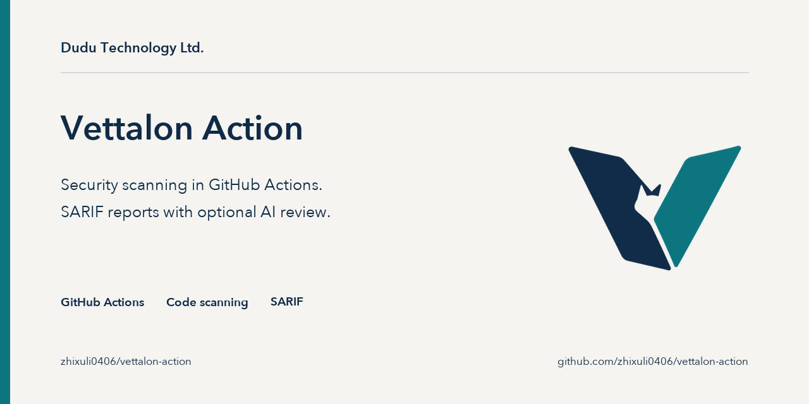

<p align="center">
  
</p>

# Vettalon security scan

A GitHub Action that checks your repository for security problems on every push and pull request, and shows the results as GitHub code scanning alerts.

It runs the open-source [Vettalon](https://github.com/zhixuli0406/vettalon) CLI. By default Vettalon runs semgrep (with a bundled offline ruleset) and gitleaks, writes a SARIF report, and the action uploads it to code scanning. No configuration, account, or API key is needed for this default mode. An optional `deep` profile adds AI review with models you configure and pay for yourself.

## Quick start

Add `.github/workflows/vettalon.yml`:

```yaml
name: Vettalon

on:
  push:
    branches: [main]
  pull_request:

permissions:
  contents: read
  security-events: write   # needed to upload SARIF to code scanning

jobs:
  scan:
    runs-on: ubuntu-latest
    steps:
      - uses: actions/checkout@v7
      - uses: zhixuli0406/vettalon-action@v1
```

Findings appear under **Security → Code scanning**. The job fails when a finding is `high` or above; change that with `fail-on`.

Requirements and limits:

- Linux and macOS runners only (`ubuntu-*`, `macos-*`). The action stops with an error on Windows.
- Code scanning uploads work on public repositories, and on private repositories with GitHub Advanced Security (GitHub Code Security). Otherwise set `upload-sarif: false` and keep the SARIF file as an artifact.
- Pull requests from forks get a read-only token, so the upload step fails there. Run the scan with `upload-sarif: false` on fork PRs if you need it to pass.
- semgrep follows its default ignore rules: it scans only files tracked by git and skips some folders, including `test/` and `tests/`, unless your repository has its own `.semgrepignore`.
- gitleaks scans git history in a checkout. `actions/checkout` fetches one commit by default; set `fetch-depth: 0` to scan the full history.

## Inputs

| Input | Default | Description |
|---|---|---|
| `version` | `latest` | CLI version: `latest` or a release tag such as `v0.1.0`. |
| `path` | `.` | Directory to scan, relative to the workspace. SARIF paths are rewritten so alerts point at the right files. |
| `profile` | `quick` | `quick`: open-source scanners only, no network calls during the scan, no AI. `deep`: adds AI review; needs `config` and your own API keys (see below). |
| `fail-on` | `high` | Fail when a finding is at or above this severity: `critical`, `high`, `medium`, `low`, `info`, or `none`. Set it to an empty string to use the CLI default (`high`, or `none` when `gates` is set). |
| `gates` | | Policy gate conditions, one per line. Each line becomes a `--gate` flag. Blank lines and lines starting with `#` are ignored. |
| `config` | | Path to a Vettalon model config (TOML) for `deep`. It must be outside the scanned directory; Vettalon refuses a config that lives inside the repository it scans. |
| `sarif-file` | `vettalon.sarif` | Where to write the SARIF report. |
| `upload-sarif` | `true` | Upload the SARIF report to code scanning. |
| `category` | | Code scanning category for the upload. Give each call its own value when one workflow scans several paths; otherwise the uploads replace each other. |
| `install-scanners` | `true` | Install semgrep (pipx, or `pip --user`) and gitleaks (official release, checksum verified) when they are not already on `PATH`. If an install fails, the scan still runs and the report lists the scanner as missing. |
| `install-method` | `release` | `release`: download the prebuilt CLI and verify its SHA-256 checksum; if no release asset exists, build from source instead. `source`: always build with `cargo install --locked --git https://github.com/zhixuli0406/vettalon`. |

## Outputs

| Output | Description |
|---|---|
| `sarif-file` | Path of the SARIF report, or empty if none was written. |
| `exit-code` | Exit code of `vettalon scan`: `0` passed, `1` `fail-on` or a gate was hit, `2` the scan could not run (bad input, unreadable path, invalid config). |

The scan step never fails on its own. The action uploads the SARIF report first and then fails in a final step if `exit-code` is not `0`, so alerts are uploaded even when the job fails. If you need `exit-code` after a failing run, add `continue-on-error: true` to the step; whether a failed composite action still exposes its outputs has not been verified for this action, so check `steps.<id>.outcome` as well.

## How the CLI is installed

With `install-method: release` the action downloads `vettalon-<os>-<arch>.tar.gz` and its `.sha256` file from the CLI's GitHub release. A missing or wrong checksum stops the job; the action never installs an unverified binary. If the server answers 404 for the tarball (the requested version has no release asset), the action builds the CLI from source with `cargo install`, which takes a few minutes; with `version: latest` that build uses the CLI's default branch, not a tagged release. Any other download error stops the job instead of falling back. GitHub-hosted runners include a Rust toolchain; on self-hosted runners install Rust 1.88 or newer first (for example with `dtolnay/rust-toolchain`). Pin `version` to a tag for reproducible builds.

## Policy gates

`fail-on` only looks at severity. Gates add conditions; the job fails if any gate fails. Tokens:

| Token | Meaning | Default |
|---|---|---|
| `severity>=LEVEL` | Count findings at or above this level | `info` |
| `status=a,b` | Count only these statuses: `candidate`, `confirmed`, `needs_human` | `candidate,confirmed` |
| `cross_family` | Count only findings upheld by a reviewer model from a different vendor, or confirmed by a person (`deep` only) | off |
| `count>N` / `count>=N` | Fail when the count reaches this (required) | |

Fail only on critical findings, and on more than five medium ones:

```yaml
      - uses: zhixuli0406/vettalon-action@v1
        with:
          fail-on: none
          gates: |
            severity>=critical count>0
            severity>=medium count>5
```

With `deep`, fail only when a high finding was upheld by a second model family or confirmed by a person:

```yaml
          gates: |
            severity>=high status=confirmed,needs_human cross_family count>0
```

## AI review (`deep`) with your own keys

`profile: deep` adds AI review on top of the scanners: one model looks for vulnerabilities in the highest-risk modules and a model from a different vendor tries to refute each finding. You bring the models and the keys. The action ships no keys, and in the default `quick` mode your code is not sent anywhere.

**Data egress:** in `deep` mode, source code from the audited modules is sent to the model providers in your config. Only use providers your organization allows to receive this code.

Write the config to `runner.temp` (outside the scanned repository) and pass keys as secrets through `env`:

```yaml
    steps:
      - uses: actions/checkout@v7
      - name: Write Vettalon model config
        run: |
          cat > "$RUNNER_TEMP/vettalon.toml" <<'EOF'
          [[model]]
          id = "deepseek"
          backend = "openai"
          family = "deepseek"
          base_url = "https://api.deepseek.com/v1"
          model = "deepseek-chat"
          api_key_env = "DEEPSEEK_API_KEY"
          roles = ["finder"]

          [[model]]
          id = "qwen"
          backend = "openai"
          family = "qwen"
          base_url = "https://openrouter.ai/api/v1"
          model = "qwen/qwen3-coder"
          api_key_env = "OPENROUTER_API_KEY"
          roles = ["verifier"]
          EOF
      - uses: zhixuli0406/vettalon-action@v1
        env:
          DEEPSEEK_API_KEY: ${{ secrets.DEEPSEEK_API_KEY }}
          OPENROUTER_API_KEY: ${{ secrets.OPENROUTER_API_KEY }}
        with:
          profile: deep
          config: ${{ runner.temp }}/vettalon.toml
```

The config never contains a key, only the name of the environment variable that holds it. Any OpenAI-compatible API works; see the CLI's [`vettalon.example.toml`](https://github.com/zhixuli0406/vettalon/blob/main/vettalon.example.toml) for all options. Notes:

- Secrets are not available to workflows triggered by pull requests from forks. Without a key the AI review is skipped, the report marks the run as incomplete, and only the scanner findings count. Do not work around this with `pull_request_target` plus a checkout of the PR branch: that hands your keys to untrusted code.
- By default the CLI reviews the 5 highest-ranked modules per run, which bounds the API cost.
- AI findings that no person has confirmed have status `needs_human`. They do not count toward `fail-on` unless you add a gate that includes them.

## Open-source core and Vettalon Pro

This action and the Vettalon CLI are free and open source (Apache-2.0). Vettalon Pro, a separate paid product with a desktop app, a local dashboard and report generation, is not needed for this action and is not used by it. See [vettalon.dudustudio.monster](https://vettalon.dudustudio.monster/#editions).

## 繁體中文說明

這個 Action 在每次 push 和 pull request 時，用開源的 Vettalon CLI 檢查程式碼的安全問題，結果會出現在 GitHub 的 Code scanning 頁面。

- 預設 `profile: quick` 只跑 semgrep 和 gitleaks，掃描過程不連網、不用 AI，也不需要任何設定或金鑰。
- 預設遇到 high 以上的發現會讓 job 失敗，可用 `fail-on` 或 `gates` 調整。SARIF 一定會先上傳，最後一步才讓 job 失敗。
- 只支援 Linux 和 macOS runner。
- `profile: deep` 會加上 AI 審查，模型和 API 金鑰都要自己準備（金鑰放 GitHub secrets，設定檔寫到 `runner.temp`，不能放在被掃描的 repo 裡）。注意：deep 模式會把被審查模組的原始碼送到你設定的模型供應商。
- 預設下載 CLI 的正式 release（目前最新是 v0.1.0）；指定的版本沒有 release 檔時，才改用 `cargo install` 從原始碼編譯，需要幾分鐘。下載的 release 檔一律驗證 SHA-256，驗證不過就停止，不會安裝。
- Action 與 CLI 都是免費開源（Apache-2.0）；付費的 Vettalon Pro 是另一個產品，這個 Action 用不到。

## License

Apache-2.0. See [LICENSE](LICENSE).
